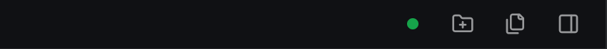

# Herdr Mods

Native add-ons for [Herdr Desktop](https://github.com/herdrdev/herdr-app). Add a project toolbar, follow parallel agent sessions, or keep a tab to one agent and one companion.

| Pack | What it adds |
| --- | --- |
| [Fielddesk Tools](fielddesk-tools/RECIPE.md) | Agent queue, session tree, handoff notes, worktree creation, and Jev status. |
| [Compact Header](compact-header/RECIPE.md) | Branch and workspace context with a shortcut to the next agent needing attention. |
| [Two-up](two-up/RECIPE.md) | Two-terminal tabs, with optional tools in separate windows. |
| [Agent Brief](agent-brief/RECIPE.md) | Agent status, session context and optional Claude prompt-cache hints. |
| [PR Review](pr-review/RECIPE.md) | A review queue and optional Dock badge for an existing compatible review engine. |

## Install

Open the recipe for a pack. It lists the folders to copy into your Herdr app home, the layout blocks or commands to use, and what the mod can access. Herdr mods run with your account's privileges. Inspect the files before installing them. Keep any existing mod with the same name by choosing a different name for the new mod and updating its references.

Use [Herdr Layouts](https://github.com/oleg-koval/herdr-layouts) for ready-made layout trees. The packs were extracted from a working Herdr Desktop 0.1.17 setup on macOS.

## Contribute

Run `npm test` with Node.js 24 before opening a pull request. Include the Herdr version and a short reproduction for UI reports. The [license](LICENSE) is MIT. Report security issues through [GitHub private vulnerability reporting](https://github.com/oleg-koval/herdr-mods/security/advisories/new).
