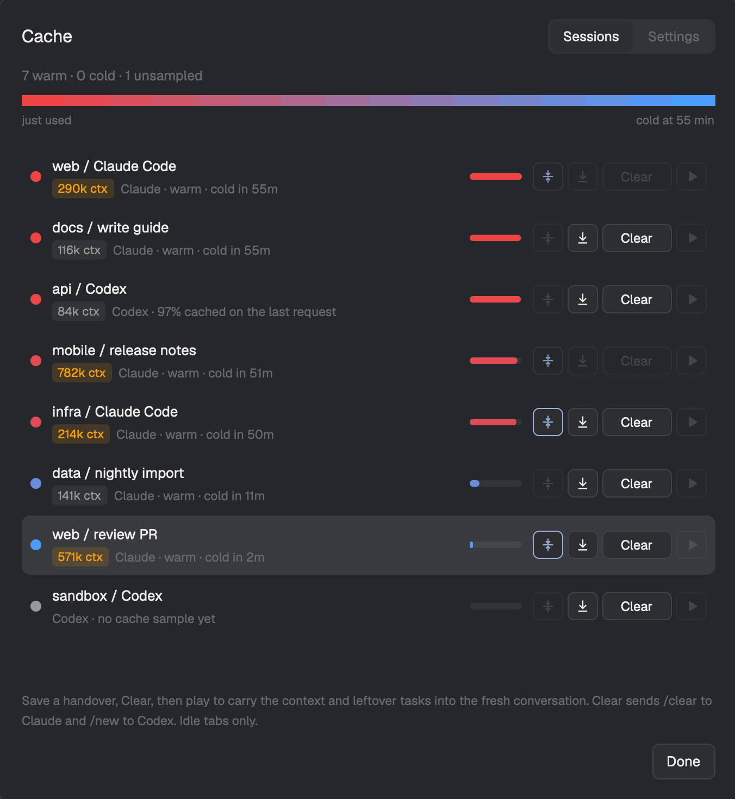
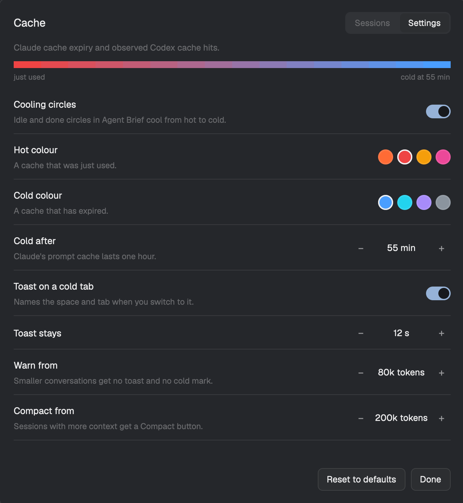

# Cache Expiry

See every Claude Code and Codex session in [Herdr Desktop](https://github.com/herdrdev/herdr-app) by prompt-cache temperature and context size, and act on it: compact, save a handover, clear, and apply the handover to the fresh conversation.



| Toolbar dot (focused tab) | Settings |
| --- | --- |
|  |  |

## Install

Requires macOS, Herdr Desktop with `hc` on your PATH, `jq`, and Python 3 for the optional Codex reader.

One line copies the mod into Herdr and adds its Claude hook to `~/.claude/settings.json` (backed up first; a hook already there is kept):

```sh
curl -fsSL https://raw.githubusercontent.com/oleg-koval/herdr-mods/main/install.sh | sh -s cache-expiry
```

Then restart running Claude sessions (or send each one a prompt) and click the cache icon in the toolbar. For Codex, add its hook as described under [Codex cache hits](#codex-cache-hits).

Or by hand:

1. Copy the mod into Herdr's app home:
   ```sh
   git clone https://github.com/oleg-koval/herdr-mods.git
   cp -R herdr-mods/cache-expiry/mods/cache-expiry ~/.config/herdr-app/mods/
   ```
2. Register the Claude hook. It labels each terminal with its conversation and records the transcript path the mod reads. Add it to `~/.claude/settings.json` under both `SessionStart` and `UserPromptSubmit`:
   ```json
   { "hooks": [{ "type": "command", "command": "bash \"$HOME/.config/herdr-app/mods/cache-expiry/claude-hook.sh\"" }] }
   ```
   It needs `jq`, does nothing outside Herdr terminals, and never blocks.
3. Optional, for Codex: register `codex-cache-hook.py` as described under [Codex cache hits](#codex-cache-hits).
4. Restart running Claude sessions (or send them one prompt) so the hook labels them. Click the cache icon in the toolbar.

Herdr mods run with your account's privileges. Read the files before installing.

## How it works

Tells you when a Claude terminal's prompt cache has gone cold. Each Claude agent's status circle cools from hot to cold as its cache ages, so you can see at a glance which conversations will be rewritten at the cache-write price on the next prompt. Switching to a cold conversation posts one toast that names its space and tab.

Copy [mods/cache-expiry](mods/cache-expiry/) into Herdr's `mods/` directory. It publishes the circle colours that [Agent Brief](../agent-brief/RECIPE.md) draws, posts the toast, and shows a cache icon with a status dot. The dot is the focused tab's own cache: its colour runs from your hot colour to your cold colour as that Claude conversation idles, or with the Codex cache-hit rate (100% hot, 0% cold). It is muted when the focused tab has no Claude or Codex session or no sample yet. Hover for this tab's state plus the totals over every tracked cache.

Herdr runs a mod only while its block is in the layout, so the indicator keeps it working. The first time Herdr sees the folder it docks the indicator at the bottom of the shown layout. Move it anywhere you like, for example under Agent Brief:

```json
{ "type": "column", "size": { "px": 300 }, "children": [
  { "type": "block", "content": { "mod": "agent-brief" }, "size": { "weight": 1 } },
  { "type": "block", "content": { "mod": "cache-expiry" }, "size": { "px": 26 }, "resizable": false }
] }
```

If you remove the block, the circles stop cooling and the toast stops.

## Sessions

Click the cache icon (or run **Cache sessions** from the command palette) to open the dialog on **Sessions**: every Claude and Codex session, hottest first, each with its colour, a bar for the warmth left, and a line such as `warm · cold in 23m · 161k tokens`, `cold · idle 2h 5m`, or `97% of input cached on the last request`. Click a row to go to that tab.

**Clear** starts a fresh conversation in that tab: it sends `/clear` to Claude or `/new` to Codex with `hc send`. The first click arms the button and the second (**Confirm**) sends. It is only offered while the session is idle or done, so it never lands in a running turn or answers a permission prompt. Clearing drops the conversation; it cannot be undone.

## Context and Compact

Each row shows the context the session's newest request carried (`258k ctx`): for Claude, input plus cache reads and writes from the transcript; for Codex, the input tokens of the last sampled request. From **Compact from** (default 200k, in Settings) the pill turns amber and the **Compact** button (arrows pointing in) lights up; it sends `/compact` to that session while it is idle or done.

## Handover

Two buttons sit either side of **Clear**:

- **Save handover** (down arrow) asks the session to write its context and leftover tasks to `~/.local/state/herdr-handover/<terminal>.md`: goal, state with receipts, decisions, a task checklist and the next step. It lights up while the file is being written and once it is saved. Saving again replaces it.
- **Apply handover** (play) stays grey until both are true: the handover file exists, and the conversation was cleared after it was asked for. Cleared means the conversation id on the terminal changed (`claude.session`, set by `claude-hook.sh` on SessionStart; `codex.cache.session` from the Codex hook), or this dialog's Clear was used. Applying moves the file to `applied/<terminal>-<time>.md` and tells the fresh session to read it and carry on from its next step.

A `<terminal>.json` beside each handover records when it was asked for and which conversation asked. Text goes to the session with `hc send`, run without `HC_TERMINAL_ID` so hc does not wrap it in `<hc from=...>` tags (a wrapped `/clear` reads as a message, not a command).

## Settings

The dialog's **Settings** tab holds the settings. Every change applies at once.

| Setting | Default | What it does |
| --- | --- | --- |
| Cooling circles | on | Idle and done circles in Agent Brief cool from hot to cold. Off keeps the status colours. |
| Hot colour | Orange | A cache that was just used. |
| Cold colour | Blue | A cache that has expired. |
| Cold after | 55 min | Idle time after which the cache counts as expired. Claude's prompt cache lasts one hour. |
| Toast on a cold tab | on | When you switch to a cold Claude tab, one toast names its space and tab. |
| Toast stays | 12 s | How long the toast stays. |
| Warn from | 80k tokens | Smaller conversations get no toast and no cold mark. |
| Compact from | 200k tokens | Sessions with more context get a Compact button in the sessions list. |

The same settings are declared in `mod.json`, so a Settings screen with a Mods page lists them too. Values are stored with `setShared` under `cache-expiry.*`; **Reset to defaults** clears them. An older install's `config.json` is imported once on first run; anything already set in the dialog wins.

The mod reads the local transcript that `claude-hook.sh` records for each terminal in `~/.local/state/herdr-idle/<terminal>`, using `tail`. Without that hook state there is nothing to cool, and the mod does nothing.

## Codex cache hits

The tooltip shows how many Codex sessions have reported usage and their aggregate cache-hit percentage. Agent Brief shows each sampled session's percentage. These percentages measure cached input tokens from the last reported request per session. A zero-hit request shows 0%. Codex expiry timing is unavailable, so the expiry colours and alerts apply only to Claude.

On macOS, the mod can read the last token counters from a local Codex session in `~/.codex/sessions` while its foreground process holds exactly one matching rollout open. Only the two counts are returned to Herdr. Detached, remote, and unmatched sessions stay unsampled until a hook report arrives.

Register the installed `codex-cache-hook.py` with Codex under both `SessionStart` and `PostModelRequest`. Use a Codex CLI with `PostModelRequest` support, Python 3, and `hc` on the terminal's PATH. For each event, add a group like this inside `hooks` in `~/.codex/hooks.json`. Substitute the actual Herdr app directory if yours differs:

```json
{ "hooks": [{ "type": "command", "command": "python3 \"$HOME/.config/herdr-app/mods/cache-expiry/codex-cache-hook.py\"", "timeout": 4 }] }
```

Review the hook entries in Codex with `/hooks`, then start or resume Codex in Herdr. The hook writes only the session ID and numeric usage to Herdr terminal labels. It does not read prompts or transcripts or make network requests.

Verify that a Claude terminal still cools as before and that a completed Codex request adds a percentage to Agent Brief and updates the tooltip. Run `npm test` and `python3 -B -m unittest discover -s cache-expiry/tests` for the logic and hook checks.
