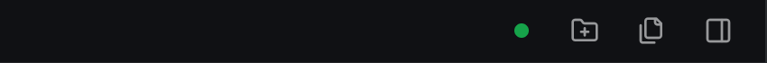

# Fielddesk Tools

Follow agents from a queue, inspect their session tree and copy a handoff without leaving the terminal. The toolbar shows the repository, offers quick actions and displays local Jev dashboard status.

Copy each folder under [mods](mods/) into your Herdr app's `mods/` directory. For the complete arrangement, use [Fielddesk](https://github.com/oleg-koval/herdr-layouts/tree/main/fielddesk).

- `fielddesk-repo` is a 36 px toolbar. It offers New task, Copy path and Toggle desk panel. Hover the dot for the dashboard status. It probes only `127.0.0.1:8791` using curl and makes no model requests. If the layout's side panel stack (`panel-body`) has a block with id `prs` (a pull-request list) or `review` (for example the [PR Review](../pr-review/RECIPE.md) board with `props: { "role": "board" }`), the toolbar adds a Pull requests or Review queue button that opens and closes it.
- `fielddesk-task` creates or reopens a Git worktree for a named task. It runs Git in the selected workspace and opens a terminal there after creation.
- `fielddesk-queue` orders agents by attention status. Selecting an agent focuses its pane or previews its terminal. Under each name it shows the space and the session's one-line context (the `herdr_context_label` label, `herdr.context` by default). With [Cache Expiry](../cache-expiry/RECIPE.md) installed, idle and done agents get a small dot that cools from hot to cold with their prompt cache; hover it for the idle time.
- `fielddesk-attention` shows the session tree and worker status. It reads Herdr's reported state and never starts workers.
- `fielddesk-handoff` shows session context and copies a handoff note on request. It reads the `herdr.context` terminal label by default. Set `herdr_context_label` in Herdr's `settings.json` to use an existing label.

Verify a live agent can be reached from the queue, a named task opens the expected worktree, and the Jev dot has a status tooltip.
